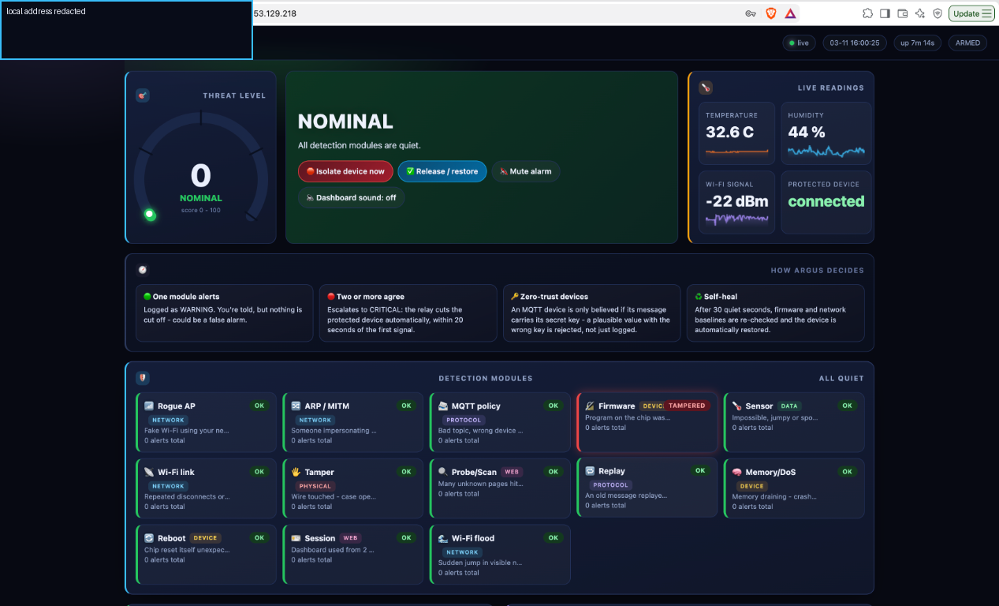
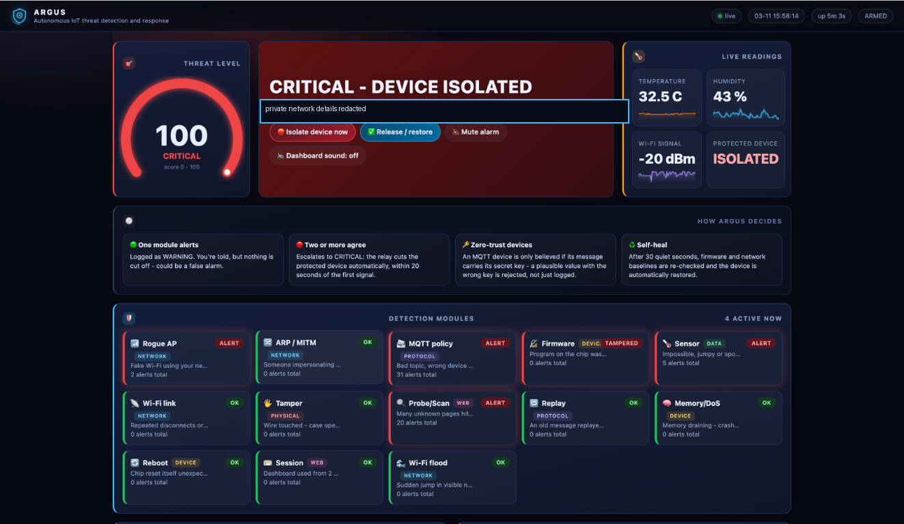
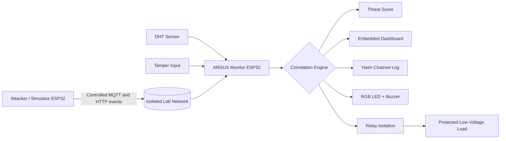
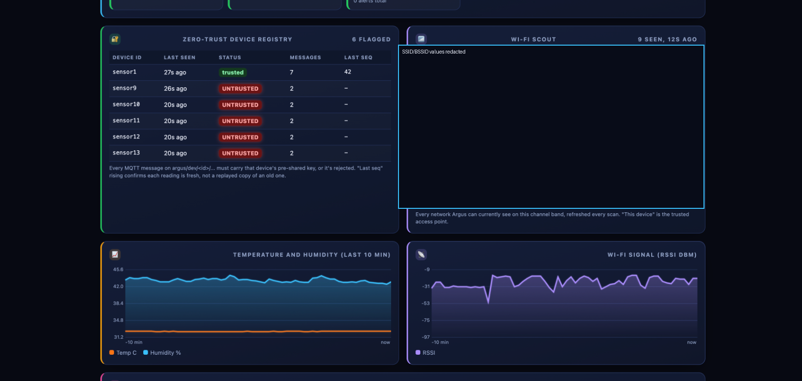
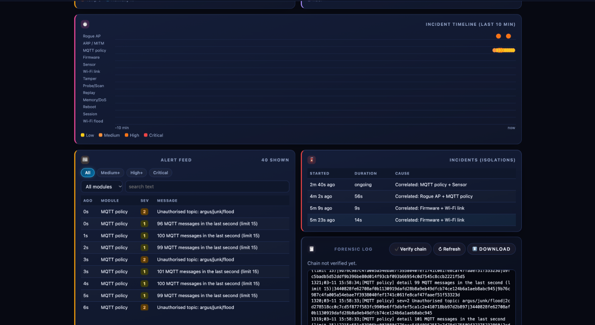
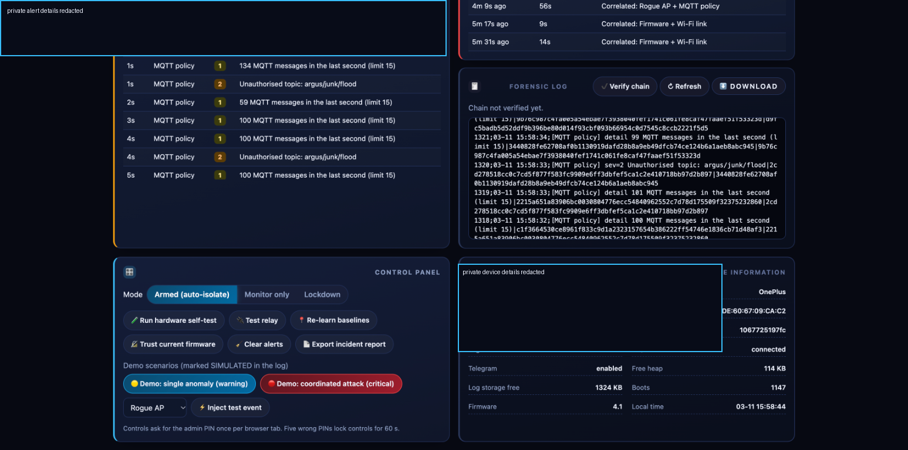
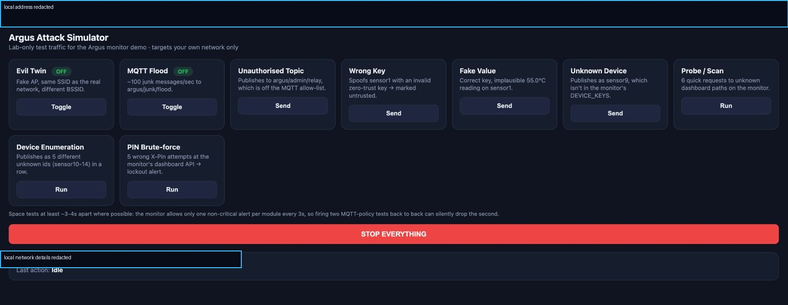

<div align="center">



# ARGUS

### Autonomous Threat Detection & Response for IoT Networks

**A self-contained ESP32 security demonstrator that detects, correlates, visualizes, and responds to IoT threats in real time.**

<p>
  
  
  
  
  
</p>

<p>
  <a href="#-why-argus">Why ARGUS</a> ·
  <a href="#-features">Features</a> ·
  <a href="#-quick-start">Quick start</a> ·
  <a href="#-documentation">Documentation</a> ·
  <a href="#-safety">Safety</a>
</p>

</div>

---

## ⚡ Why ARGUS?

Most small IoT projects can report sensor values, but they cannot explain when the environment around them becomes hostile. ARGUS adds a security layer around a protected IoT device:

```text
Observe  →  Detect  →  Correlate  →  Isolate  →  Verify  →  Recover
```

It combines network signals, MQTT behavior, firmware integrity, environmental readings, physical tamper sensing, and dashboard activity. One suspicious signal produces a warning; independent signals observed close together can escalate to a critical incident and disconnect the protected low-voltage load through a relay.

<div align="center">

<br>
<sub><b>Critical incident:</b> correlated detections trigger automatic protected-device isolation.</sub>
</div>

## ✨ Features

<table>
<tr>
<td width="33%" valign="top">

### 🛡️ Detection

- Rogue access-point detection
- ARP/MITM gateway monitoring
- MQTT policy enforcement
- Replay and unknown-device detection
- Probe and PIN brute-force detection
- Wi-Fi link and beacon-flood monitoring

</td>
<td width="33%" valign="top">

### 🧠 Intelligence

- Multi-module event correlation
- Warning and critical threat levels
- Firmware SHA-256 verification
- Zero-trust MQTT device keys
- Sequence tracking for fresh messages
- Hash-chained forensic logging

</td>
<td width="33%" valign="top">

### 🚨 Response

- Relay-based load isolation
- RGB LED and buzzer alerts
- Embedded responsive dashboard
- Incident timeline and alert feed
- Self-heal after a quiet period
- Optional Telegram notifications

</td>
</tr>
</table>

## 🏗️ System architecture

<div align="center">



</div>

### Decision model

| State | Meaning | ARGUS behavior |
|:---:|---|---|
| 🟢 **NOMINAL** | All monitored signals are within learned baselines | Continue monitoring |
| 🟡 **WARNING** | One detection module reports an anomaly | Record and display evidence |
| 🔴 **CRITICAL** | Two or more independent modules agree within the correlation window | Isolate the protected load and raise an incident |
| 🔄 **RECOVERY** | The environment has remained quiet | Recheck baselines before restoration |

## 📸 Dashboard tour

<div align="center">
<table>
<tr>
<td></td>
<td></td>
</tr>
<tr>
<td align="center"><sub><b>Zero-trust registry & Wi-Fi scout</b></sub></td>
<td align="center"><sub><b>Timeline, alerts & forensic evidence</b></sub></td>
</tr>
<tr>
<td></td>
<td></td>
</tr>
<tr>
<td align="center"><sub><b>Controls, isolation & device health</b></sub></td>
<td align="center"><sub><b>Authorized lab-only simulator</b></sub></td>
</tr>
</table>
</div>

> Images in this repository are public-documentation copies. Private local network identifiers have been redacted.

## 🔍 Detection modules

| # | Module | What it observes |
|---:|---|---|
| 0 | Rogue AP | Trusted SSID appearing with an unexpected BSSID |
| 1 | ARP / MITM | Changes to the gateway MAC address |
| 2 | MQTT policy | Unknown topics, devices, keys, payloads, and message floods |
| 3 | Firmware | Difference between the running image and trusted SHA-256 |
| 4 | Sensor | Impossible values, abrupt jumps, disconnects, and foreign publishers |
| 5 | Wi-Fi link | Repeated disconnects and sudden signal degradation |
| 6 | Tamper | Change on the physical capacitive-touch input |
| 7 | Probe / Scan | Unknown dashboard paths and repeated failed PIN attempts |
| 8 | Replay | Reused or out-of-sequence MQTT messages |
| 9 | Memory / DoS | Abnormal free-heap exhaustion |
| 10 | Reboot | Panic, watchdog, or brownout reset conditions |
| 11 | Session | Dashboard control requests from a second client |
| 12 | Wi-Fi flood | Sudden growth in visible wireless networks |

<details>
<summary><b>How escalation works</b></summary>

ARGUS applies a per-module debounce interval to prevent alert spam. Detail events remain visible in the alert feed, while the correlation engine looks for agreement between different modules inside the configured time window. This makes the critical decision more meaningful than reacting to one noisy signal.

</details>

## 📦 Repository

```text
ArgusShield/
├── Argus_Monitor/
│   ├── Argus_Monitor.ino       # Main monitor firmware
│   └── dashboard_html.h        # Embedded dashboard
├── Argus_Attacker/
│   └── Argus_Attacker.ino      # Controlled event simulator
├── docs/
│   ├── ARGUS_IoT_Project_Report.pdf
│   └── images/                  # Redacted README screenshots
├── .gitignore
└── README.md
```

## 🔧 Hardware

| Component | Purpose |
|---|---|
| ESP32 DevKit V1 | Monitor controller |
| DHT11 or DHT22 | Temperature and humidity telemetry |
| 1-channel relay | Protected-load isolation |
| RGB LED + 3 × 220 Ω resistors | Visual threat state |
| Active buzzer | Audible alert |
| Loose jumper wire | Capacitive tamper input |
| Low-voltage fan or LED load | Safe demonstration load |

### Monitor pin map

| Function | GPIO | Function | GPIO |
|---|---:|---|---:|
| DHT sensor | 4 | Relay | 5 |
| RGB red | 25 | RGB green | 26 |
| RGB blue | 27 | Buzzer | 14 |
| Tamper touch | 13 | BOOT button | 0 |
| On-board LED | 2 | | |

> **Electrical safety:** use only low-voltage loads. Do not connect mains electricity. Disconnect power before changing wiring. Read the relay notes at the top of [`Argus_Monitor.ino`](Argus_Monitor/Argus_Monitor.ino).

## 🚀 Quick start

### 1. Install the toolchain

- Arduino IDE or Arduino CLI
- ESP32 board support package
- Board: **ESP32 Dev Module**
- Serial Monitor: **115200 baud**
- Libraries: `DHTesp` and `PubSubClient`
- Optional: Mosquitto for MQTT demonstrations

### 2. Configure locally

Both sketches contain safe placeholders. Replace them locally before flashing, but never commit the edited values:

<details>
<summary><b>Monitor settings</b></summary>

In [`Argus_Monitor.ino`](Argus_Monitor/Argus_Monitor.ino), set:

```cpp
WIFI_SSID, WIFI_PASS, ADMIN_PIN
MQTT_HOST, DEVICE_KEYS
```

Leave `BOT_TOKEN` and `CHAT_ID` empty unless Telegram is intentionally enabled.

</details>

<details>
<summary><b>Attacker settings</b></summary>

In [`Argus_Attacker.ino`](Argus_Attacker/Argus_Attacker.ino), set:

```cpp
WIFI_SSID, WIFI_PASS, MQTT_HOST
ARGUS_IP, GOOD_KEY
```

Use the simulator only on an isolated network containing hardware you own or are authorized to test.

</details>

### 3. Upload and open the dashboard

1. Wire the monitor using the pin map.
2. Upload [`Argus_Monitor.ino`](Argus_Monitor/Argus_Monitor.ino).
3. Open Serial Monitor at 115200 baud.
4. Wait for Wi-Fi connection and baseline learning.
5. Open `http://argus.local` or the IP printed by the monitor.
6. Run the hardware self-test with a low-voltage load.
7. Optionally upload the attacker simulator to a second ESP32.

## 🎬 Demonstration scenarios

The attacker dashboard and Serial Monitor can generate:

`Evil Twin` · `MQTT Flood` · `Unauthorized Topic` · `Wrong Key` · `Fake Value` · `Unknown Device` · `Probe / Scan` · `Device Enumeration` · `PIN Brute-force`

Run one scenario at a time and allow the monitor's debounce interval to expire between related tests. Stop all simulator activity after the demonstration.

## 🖥️ Controls and API

### Serial commands

```text
help
status
verify
sim <0-12>
isolate
release
trust
rebase
wipe
```

### Dashboard endpoints

| Endpoint | Purpose |
|---|---|
| `/` | Embedded monitor dashboard |
| `/api/status` | Current level, score, readings, and module states |
| `/api/history` | Chart history |
| `/api/log` | Recent forensic entries |
| `/api/log.txt` | Full log download |
| `/api/verify` | Verify the hash chain |
| `/api/devices` | Zero-trust device registry |
| `/api/scan` | Wi-Fi scout results |
| `/api/cmd` | PIN-protected controls |

## ✅ Validation checklist

- [ ] Monitor starts with no committed credentials.
- [ ] Wi-Fi and MQTT status are visible.
- [ ] Sensor readings update.
- [ ] Relay, RGB LED, buzzer, and tamper input work.
- [ ] Firmware hash verification succeeds.
- [ ] Invalid keys and unknown devices are rejected.
- [ ] Correlated events create a critical incident.
- [ ] Critical mode isolates the protected load.
- [ ] Forensic log verification succeeds.
- [ ] Public screenshots contain no private identifiers.

## 📚 Documentation

The complete technical report includes the design, wiring, implementation, testing scenarios, and results:

**[Read the full ARGUS IoT Project Report →](docs/ARGUS_IoT_Project_Report.pdf)**

## ⚠️ Safety and limitations

- This is a laboratory prototype, not a production security appliance.
- Use only on hardware and networks you own or are explicitly authorized to test.
- The dashboard uses HTTP on the local network and is not an HTTPS management interface.
- MQTT security depends on the local broker and network configuration.
- Wi-Fi and ARP behavior varies with ESP32 core versions and radio conditions.
- Do not connect the relay to mains electricity.
- Rotate any credential immediately if it has ever been exposed.

## 📄 License

No license has been selected yet. Add an appropriate license before accepting contributions or permitting reuse.

<div align="center">

<br>

**Built for IoT security experimentation, visibility, and responsible learning.**

</div>
